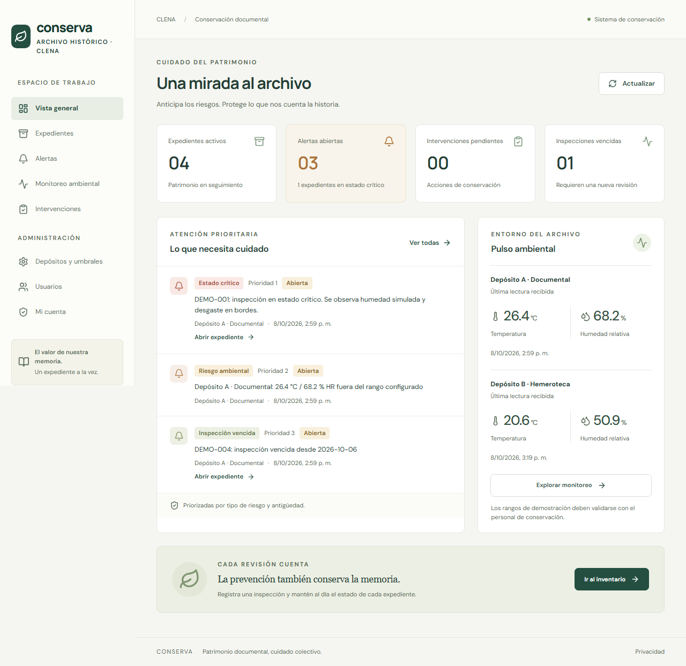

# Proyecto Final Backend CLENA P3

Repositorio de Conserva: monitoreo y alertas de conservación del Archivo Histórico.

[Repositorio GitHub](https://github.com/Yutaerre21/ProyectoFinalBackend) · [Issue de implementación inicial #1](https://github.com/Yutaerre21/ProyectoFinalBackend/issues/1) · [Integración continua](https://github.com/Yutaerre21/ProyectoFinalBackend/actions)

La versión inicial se presenta en `feat/1-monitoreo-conservacion`. La base de `main` se creó únicamente para inicializar el repositorio vacío y permitir el Pull Request. La implementación requiere revisión de un compañero y CI aprobado antes de fusionarse. Esta importación del trabajo local no representa tres sprints ni aportes de otros integrantes.

Aplicación de **monitoreo y alertas de conservación del Archivo Histórico**, construida para resolver el alcance P3 del taller «Proyecto Final Backend — Soluciones para el CLENA».

El problema: las revisiones visuales esporádicas no permiten anticipar humedad, plagas o desgaste. Conserva centraliza inventario, inspecciones, lecturas ambientales, alertas priorizadas e intervenciones asignadas.



## Arranque en un comando

Requisito: Docker Desktop iniciado con contenedores Linux y Docker Compose.

```sh
docker compose up -d --build
```

El comando crea secretos aleatorios, PostgreSQL 17, ejecuta migraciones y semillas ficticias, inicia NestJS y sirve React mediante Nginx. No hay que copiar un `.env` para este modo.

- **Aplicación:** http://localhost:8080
- **Swagger:** http://localhost:3000/docs
- **Salud:** http://localhost:3000/health

Obtén la contraseña aleatoria de las cuentas de demostración:

```sh
docker compose exec backend cat /run/config/demo_password
```

| Cuenta                   | Rol                               |
| ------------------------ | --------------------------------- |
| `admin@clena.example`    | Administrador                     |
| `personal@clena.example` | Personal CLENA                    |
| `publico@clena.example`  | Público, sin acceso al inventario |

Las tres usan la contraseña generada. Son exclusivamente cuentas de demostración. No publiques esa contraseña ni el volumen de configuración. Para apagar sin borrar datos: `docker compose stop`; para volver: `docker compose up -d`.

## Alcance implementado

- Inventario con código, título, depósito, estantería, caja y periodicidad de inspección; edición y archivo lógico.
- Inspecciones Óptimo / Regular / Crítico, observaciones de humedad, plagas y desgaste e historial por expediente.
- Alertas por estado crítico, inspección vencida y lectura ambiental fuera de rango. Evaluación de vencimientos cada minuto.
- Ingesta de temperatura y humedad autenticada y simulador sin hardware.
- Tablero priorizado y tareas con responsable, fecha límite, estado y resultado.
- JWT access/refresh con rotación, bcrypt, roles y anonimización de cuenta.
- API versionada, Swagger, validación, errores uniformes, filtros, paginación, ordenamiento, salud y logs JSON.
- PostgreSQL con migraciones, claves foráneas, índices y datos ficticios.
- React responsive con rutas por rol, formularios etiquetados y navegación por teclado.

Los rangos iniciales de **18–24 °C y 40–60 % HR son ejemplos para pruebas**, no recomendaciones técnicas de conservación. Deben validarse con G7 y el personal del archivo.

## Documentación de la entrega

- [Solución escrita del taller P3 en PDF](docs/SOLUCION-P3.pdf) y [versión editable](docs/SOLUCION-P3.md)
- [Requisitos y trazabilidad](docs/requisitos.md)
- [Backlog con historias, criterios y puntos](docs/product-backlog.md)
- [Arquitectura y decisiones](docs/arquitectura.md)
- [Modelo de datos y diagrama ER](docs/modelo-datos.md)
- [Manual de usuario](docs/manual-usuario.md)
- [Manual de operación, despliegue y respaldo](docs/manual-operacion.md)
- [Guion de demo y sustentación](docs/demo.md)
- [Estado de pruebas y evidencias técnicas](docs/verificacion.md)
- [Scrum y pendientes verificables](docs/evidencias.md)

## Stack y estructura

NestJS 11 + TypeScript · React 19 + Vite · TypeORM · PostgreSQL 17 · Docker Compose.

```text
backend/src/
  domain/          Entidades, reglas puras y puertos
  application/     Casos de uso sin NestJS ni TypeORM
  infrastructure/  Repositorios, JWT/bcrypt, migraciones y semilla
  presentation/    Controladores, DTOs HTTP, guards y filtro
  app.module.ts    Composición mediante tokens de inyección
frontend/src/      Pantallas, sesión y cliente REST
backend/test/      Unitarias y e2e con PostgreSQL
tests/browser/    Pruebas de navegador
scripts/          Simulador, bootstrap Docker y pruebas aisladas
docs/             Entregables del taller
```

## Verificación local

Node.js 24 y npm. Desde la raíz:

```sh
npm ci
npm run lint
npm test
npm run build
npm run test:e2e:docker
npm run test:browser
```

El último comando requiere la aplicación Docker iniciada y Chromium instalado con `npx playwright install chromium`. La suite e2e crea y elimina **su propio contenedor de pruebas**; no toca la base de demostración. GitHub Actions ejecuta lint, unitarias, e2e y build en cada PR. La cobertura mínima exigida es 70 % para dominio y aplicación.

Para desarrollar: configura las variables de `.env.example` en `backend/.env` con una PostgreSQL local, ejecuta `npm run dev:api` y `npm run dev:web`. Vite usa http://localhost:5173 y envía `/api` al backend en el puerto 3000. Mantén `synchronize: false`; las migraciones se aplican al iniciar.

## Simulador en PowerShell

```powershell
$env:SENSOR_PASSWORD = (docker compose exec -T backend cat /run/config/demo_password).Trim()
$env:SENSOR_COUNT = '12'
npm run simulate
Remove-Item Env:SENSOR_PASSWORD
```

Cada cuarta secuencia genera una lectura anómala; las siguientes normales permiten comprobar la resolución de la alerta. Variables opcionales: `API_URL`, `SENSOR_EMAIL`, `SENSOR_DEPOSIT_ID`, `SENSOR_INTERVAL_MS` (mínimo 1000).

## Equipo y estado institucional

- Proyecto elegido por el usuario: **P3**.
- Equipo de origen: **G7**; contacto indicado en el taller: **Santiago Herrera Arévalo**.
- Análisis de origen: [repositorio G7](https://github.com/jjparraroa-lab/proyect_into_ingsistemas).
- Integrantes Backend y asignación nominal de PO/SM/Development Team: **no suministrados**.
- URL pública: **pendiente de seleccionar y configurar hosting**; localhost no cuenta como despliegue público.
- Licencia y propiedad: **pendientes de acuerdo con CLENA y universidad**, como pide el enunciado.

El código y la documentación técnica están preparados. La reunión con G7, validación del backlog, ceremonias reales grabadas en Teams, Issues/Projects/PRs revisados, invitación al docente `djromerom`, despliegue público y acta de aceptación deben realizarse y documentarse por el equipo. Los archivos de Scrum describen la propuesta y los registros requeridos; **no certifican reuniones que no han ocurrido**.
